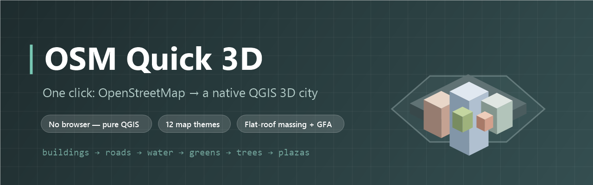

<div align="center">



# OSM Quick 3D

**OpenStreetMap as native QGIS layers, with the buildings in the QGIS 3D view.**

[](https://github.com/YusufEminoglu/osm_quick_3d/releases)
[](LICENSE)
[](https://geophilo.com/osm_quick_3d/manual.html)
[](https://qgis.org)
[](https://www.openstreetmap.org/copyright)

Pick an area on the map and press **Download & build 3D**. OpenStreetMap
buildings, roads, water, greens, trees and street furniture arrive as styled,
editable layers in one layer group, and the buildings are extruded as block
models (LOD1, flat roofs) in the QGIS 3D view. No browser, no web server and
no extra Python packages are needed.

[Install](#installation) · [What you get](#what-you-get) · [Downloading](#downloading-from-openstreetmap) · [Saving](#saving-your-work) · [Dock](#the-dock) · [Which plugin?](#which-plugin-do-i-want) · [Manual](https://geophilo.com/osm_quick_3d/manual.html)

</div>

---

## Documentation

The **[reference manual](https://geophilo.com/osm_quick_3d/manual.html)** covers every control, parameter and workflow. Bugs and requests go to [GitHub issues](https://github.com/YusufEminoglu/osm_quick_3d/issues).

## Why OSM Quick 3D?

| | |
|---|---|
| **Real QGIS layers** | Everything arrives as native vector layers in one layer-tree group, ready to analyse, edit, label, print or export. Nothing is locked inside a viewer. |
| **3D buildings in QGIS** | Buildings are extruded with native QGIS 3D symbology, with a 0.5× to 5.0× height factor for low-rise districts. |
| **12 map themes, 10 building colour modes** | One choice recolours buildings, roads, water, greens, the base and the 3D buildings together. |
| **Planning quantities** | Every building carries `footprint_m2` and an estimated `gfa_m2` (gross floor area), and the run reports the totals. |
| **Larger areas** | Areas up to 2,500 km² are split into tiles of at most 100 km², because native layers handle far more buildings than a web 3D scene. |

---

## What you get

One run downloads and styles the layers you tick, clipped to your study-area
shape (**rectangle, rounded rectangle, circle, hexagon, or your own selected
polygon**), taken from the visible map extent or the extent of the selected
features:

```text
OSM Quick 3D — EPSG:xxxxx          one layer-tree group, in the area's UTM zone
 ├─ OSM Buildings      by OSM use or by height; footprint_m2, gfa_m2; extruded in 3D
 ├─ OSM Roads          by highway class, metric widths (honours OSM width=*)
 ├─ OSM Bike lanes     highway=cycleway
 ├─ OSM Waterlines     rivers, streams and canals as ribbons
 ├─ OSM Water areas    lakes, ponds, reservoirs, riverbanks
 ├─ OSM Greens         parks, forests, orchards and other greens, plus car parks and plazas
 ├─ OSM Trees          OSM tree points and trees planted in parks and woods
 ├─ OSM Bus stops, OSM Benches, OSM Street lights, OSM Trash bins
 ├─ OSM Base           optional study-area base (2D)
 └─ OSM Base 3D        optional recessed plinth under the 3D model
```

Layers with nothing in the area are not added.

- **Building heights** come from the OSM `height` tag; otherwise from the floor
  count (`building:levels`, 3 m per floor); otherwise from a default floor
  count for the building type (2 for a house, 4 for apartments, 5 for an
  office, 1 for a warehouse, 3 when the type is unknown). `min_height` and
  `building:min_level` lift building parts off the ground. Floor counts are kept between 1 and
  200 and heights between 1 and 1,000 m; a value that is not a finite
  number is ignored.
- **Trees.** OSM trees stand where they are mapped. Parks, woods, gardens,
  cemeteries and other greens are rarely mapped tree by tree, so the plugin
  plants trees inside them, at most 130 per area and 500 per run, in the same
  places on every run. In 3D, each tree is a brown trunk with a round crown,
  in three sizes by height (under 5.5 m, 5.5 to 9 m, 9 m and taller).
- **Relation multipolygons** are imported, so courtyard buildings and parks
  with holes are kept, including an island inside a hole. Rings are stitched
  from their member ways, two-point ways included.
- **Not drawn as roads:** roads in tunnels (`tunnel=yes` or `culvert`), and
  roads tagged `proposed`, `construction`, `abandoned`, `disused`, `razed` or
  `demolished`.
- An optional **basemap underlay** is moved beneath the city and clipped to
  the base, so the 3D view shows a clean island instead of a full rectangle.
  An optional **DEM** can be used as terrain in the 3D view.
- Optional **name labels** for buildings and roads.

---

## Downloading from OpenStreetMap

The data comes from the public Overpass API servers **overpass-api.de** and
**overpass.private.coffee**. overpass-api.de is asked first until a server has
delivered; after that, the server that last delivered is asked first.

- **QGIS stays usable.** The download runs in the background as a QGIS task.
  The status line says which server is being asked and counts the seconds,
  and **Cancel** frees the dock within two seconds; a result that has already
  arrived is kept and built.
- **Polite to the servers.** Each server gets one request per tile; only on
  QGIS 4 (Qt 6) is it asked once more after a dropped connection, because on
  QGIS 3 Qt already re-sends by itself. A server that answers 429 (too many
  requests) rests for a minute, one that refuses (403 or 406) for an hour, a
  busy one (5xx) for 45 seconds and one that does not answer for 2 minutes,
  and the rest doubles while it keeps failing. The rests are kept in the QGIS
  settings, so they hold across QGIS sessions. A large download stops early
  when every server is resting, and one click sends at most 64 requests.
  Queries carry `[timeout:N][maxsize:134217728]`, a transfer lasts at most 55
  seconds, and answers are cut at 64 MiB. Every request carries the `Referer`
  https://github.com/YusufEminoglu/osm_quick_3d, and where QGIS allows it
  (QGIS 4.2, not 3.44) the User-Agent ends with `OSM-Quick-3D-QGIS-Plugin`.
- **Large areas.** The **Max area** control goes up to 2,500 km². Areas above
  100 km² are split into at most 40 tiles, downloaded one after the other and
  merged without duplicates at the seams. If some tiles fail, the layers that
  arrived are still built, and the summary says "Partial result:" and which
  part is missing.
- **Cache.** Complete answers are kept on this computer for a week, so running
  the same area again opens at once without asking the servers. Empty answers
  and answers carrying a server remark are never stored. **Clear cache** in
  the Build tab deletes the stored answers.
- If every server fails, one plain message names each server asked and what
  it answered.

The OSM data, tile service and Overpass API notices are in
[`THIRD_PARTY_NOTICES.md`](THIRD_PARTY_NOTICES.md).

---

## Saving your work

- **Save result to GeoPackage (with 2D+3D styles)** writes every layer, with
  its 2D and 3D style as the default style, into a GeoPackage you choose, and
  loads the layers from it, so they survive saving and reopening the project.
- The file is asked for before the download starts; cancelling the file
  dialog cancels the run. A path that exists but is not a GeoPackage is
  refused before anything is downloaded.
- An existing GeoPackage is never recreated and no table in it is replaced:
  the layers go into new tables. When a name is already taken, the whole run
  uses the next free number (`buildings_2`, `roads_2` and so on), so running
  again into the same file works even while the earlier layers are loaded.
  The summary lists the tables written, and names any layer that could not be
  saved and why.
- Without a GeoPackage, the layers are temporary (memory) layers. The summary
  after the run says that they vanish when the project is reopened.

---

## The dock

One dockable panel with two tabs. **Download & build 3D**, **Cancel** and the
status line stay below the scrolling settings, visible on small screens. The
status line and the summary of the last run sit in a footer under both tabs,
and the summary stays until the next run. Errors appear there in short words,
never in a modal box; the details go to the QGIS log (OSM Quick 3D).

| Tab | What it holds |
|---|---|
| **Build** | **Add OSM basemap**; area source, shape and **Max area** with a live readout of the map extent; layer choices (buildings, roads and cycleways, water, green areas, trees, street furniture, name labels); initial appearance and 3D (3D extrusion, height factor, map theme, building colours, height classes, shade variation, 2D sun drop-shadow, 2.5D depth, recessed ground base, open the 3D view, Eye-Dome Lighting, 3D map resolution); output and terrain (basemap underlay, DEM and its vertical scale, GeoPackage, OSM cache and **Clear cache**). |
| **Theme & Style** | Changes the downloaded result without downloading again. **Theme & Scene:** the target group, theme, palette preview, background colour, 3D view buttons (**Open 3D**, **Refresh**, **Focus**, **Close**) with its state, layers, basemap clip and resolution, DEM terrain and scale, Eye-Dome Lighting, sun angle, and **Save 2D Map PNG…**. **3D Layer Visibility:** hide a layer in 3D while keeping it in 2D. **Building Visuals:** height factor, building colours, height classes (continuous, discrete intervals, quantile), opacity, shade variation, 2D drop-shadow, 2.5D depth, name labels, ground base and 3D resolution (256 to 4096 px). **Surface Palette:** major and minor roads, green areas, water. **Detail Layers:** tree canopy colour and tree size. |

The 3D sun shadow and ambient occlusion switches of 0.51 are gone: QGIS 3.44
and 4.2 give plugins no access to those settings, so the switches did nothing.

On an empty map, **Download & build 3D** is switched off and the dock says
the map is empty: click **Add OSM basemap**, then zoom to your area.

**Map themes:** Muted Planning, Tokyo Cyber, Editorial Paper, Nordic Frost,
Monochrome Noir, Civic Atlas, Mediterranean Survey, Night Print, Anime Cel,
Desert Dunes, Pastel Candy, Vaporwave.

**Building colours:** by function (OSM use), by height, or a soft tint ramp by
height: gray, warm, teal, salmon, purple, sand, copper and bronze, Nordic
glacier. The same colours are used in 2D and 3D.

---

## Which plugin do I want?

| | **OSM Quick 3D** *(this plugin)* | [3D OSM Model](https://gitlab.com/geophilo1/osm_3d_model) | [QuickOSM](https://plugins.qgis.org/plugins/QuickOSM/) |
|---|---|---|---|
| What you get | Styled, editable QGIS layers and 3D buildings in the QGIS 3D view | Styled QGIS layers plus a 3D city in a Three.js viewer in your browser | Raw OSM layers for any tags you query |
| Area | Up to 2,500 km² | Up to 300 ha | Any area the Overpass server accepts |
| 3D | Block models (LOD1, flat roofs) in QGIS | Roofs, facades, traffic and pedestrians; GLB export | None |
| Styling | 12 themes for 2D and 3D | Themes for the map and the viewer | None (QGIS defaults) |
| Choose it for | Analysis, editing, planning quantities, print maps of larger areas | Presentation scenes, walk-throughs, images, video, Blender | Custom queries for any OSM tag, and Processing models |

Since 0.52.0, the Overpass client of OSM Quick 3D follows the same design as
the one in 3D OSM Model 1.10.0, so both follow the same server rules.

---

## Installation

**From the QGIS Plugin Hub** (recommended)
> `Plugins → Manage and Install Plugins…` → search **OSM Quick 3D** → Install.

**From a ZIP**
> Download the zip from the [release list](https://github.com/YusufEminoglu/osm_quick_3d/releases) or the [Hub page](https://plugins.qgis.org/plugins/osm_quick_3d/) → `Plugins → Manage and Install Plugins… → Install from ZIP`.

**From source** (development)
```powershell
git clone https://gitlab.com/geophilo1/osm_quick_3d
$env:QGIS_PLUGINPATH = "C:\path\to\folder-containing-osm_quick_3d"   # then restart QGIS
```

| Requirement | Value |
|---|---|
| QGIS | 3.28 or later, QGIS 4 included. Without the QGIS 3D module the layers are still styled in 2D. |
| Dependencies | None beyond QGIS |
| Network | An internet connection for the OpenStreetMap download |
| License | [MIT](LICENSE); data © [OpenStreetMap contributors](https://www.openstreetmap.org/copyright) (ODbL) |

---

## Tests

- `tests/test_pure_logic.py` checks the parsing, floor count, UTM, width and
  cache logic on plain Python, with an isolated cache folder.
- Four QGIS suites run on QGIS 3.44 and 4.2 against local fake servers, with
  no public network traffic: `tests/test_overpass_rules_qgis.py` (the
  Overpass rules), `tests/test_osm_fidelity_qgis.py` (data fidelity),
  `tests/test_save_qgis.py` (saving) and `tests/test_dock_qgis.py` (the
  dock).
- The code passes the QGIS Plugin Hub security scan (Bandit).

---

## Part of the PlanX family

OSM Quick 3D is one of 31 QGIS plugins by the same author. Related plugins for urban planning:

| Planning & analysis | CAD & production | 3D & visualization |
|---|---|---|
| [PlanX](https://github.com/YusufEminoglu/PlanX) — urban analytics studio | [CAD Drafting Toolset](https://github.com/YusufEminoglu/PlanX-CAD) — drafting, measurement, road platforms | [3D City Studio](https://github.com/YusufEminoglu/planx_3d_city) — QGIS to Three.js city viewer |
| [GeoStats Lab](https://github.com/YusufEminoglu/planx_geostats) — spatial statistics | [EasyFillet](https://github.com/YusufEminoglu/EasyFillet) — tangent-arc fillet | [3D OSM Model](https://github.com/YusufEminoglu/osm_3d_model) — OSM to a 3D city in the browser |
| [MCDA Suitability Lab](https://github.com/YusufEminoglu/planx_suitability_lab) — raster MCDA | [Settlement Planning Toolset](https://github.com/YusufEminoglu/PlanX-Settlement) — block-to-parcel settlement plans | [OSM Quick 3D](https://github.com/YusufEminoglu/osm_quick_3d) — OSM to native QGIS 3D |
| [DataCube Lab](https://github.com/YusufEminoglu/planx_datacube) — space-time data cubes | [UIP Zoning Plan Toolset](https://github.com/YusufEminoglu/PlanX-UIP) — Turkish implementation plans | [Urban Procedural 3D Studio](https://github.com/YusufEminoglu/planx_urban_procedural_3d) — parametric zoning lab |
| [Urban Resilience Lab](https://github.com/YusufEminoglu/planx_urban_resilience) — seismic, flood, heat and social vulnerability | [ParcelFlux](https://github.com/YusufEminoglu/parcelflux) — parcel subdivision | [02CartoLab](https://github.com/YusufEminoglu/zero2cartolab) — thematic maps and print layouts |

---

## Contributing and support

- **Bugs and requests:** [GitHub issues](https://github.com/YusufEminoglu/osm_quick_3d/issues)
- **Changelog:** [CHANGELOG.md](CHANGELOG.md), in the *Keep a Changelog* format
- Before a pull request, run `py -3 tests/test_pure_logic.py` (no QGIS needed) and the QGIS suites.

## Author

**Geophilo** · [GitHub](https://github.com/YusufEminoglu) · yusuf.eminoglu@deu.edu.tr

<div align="center">
<sub>Map data © OpenStreetMap contributors, ODbL.</sub>
</div>
